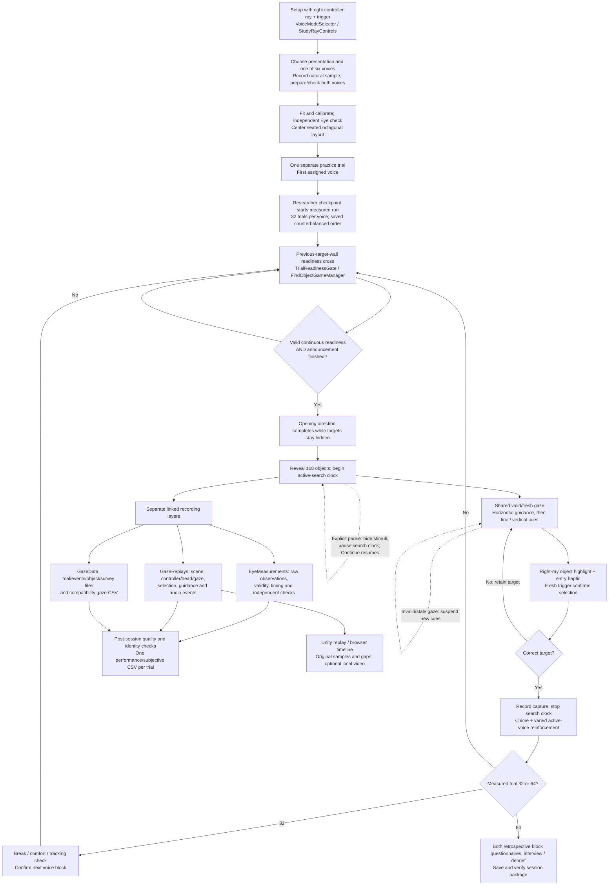

# Current system diagram

**Implemented locally — October 1, 2026; headset acceptance pending.** The runtime uses seated octagonal search, hidden targets, the same gaze-contingent commands in both voice conditions, and right-controller ray/trigger selection. The older table-tap, dwell-selection, alternating gaze-awareness and 14-round diagrams are historical. Existing `diagram.pdf`, `diagram_chart.png` and other old exports have not been regenerated and must not be treated as current.

**Protocol proposal:** consent, external questionnaires, breaks, refitting and debrief sit around the runtime. Their final instruments and operator order require research review. The figure does not establish approval, eye-tracking validity or power.

[Setup/session vector figure and caption](../resources/figures/follow-my-voice-study-flow-20261001.md) · [Runtime overview](guide/01-system-overview.md) · [Round flow](guide/02-gameplay-round-flow.md) · [Telemetry](guide/03-gaze-agent-and-telemetry.md)

The first practice initializes at room front; later readiness uses the previous target wall. The diagram's loop summarizes measured trials; practice remains separately identified. A correct choice ends active-search timing before success feedback, and recording continues through that feedback. Invalid gaze is not a head-gaze fallback. Explicit participant-requested pauses and technical stops retain their outcomes.

The editable Mermaid source is [diagram.mmd](diagram.mmd). This diagram summarizes responsibilities; precise thresholds, missingness rules and recorded-field definitions belong to the linked guides and source code.
