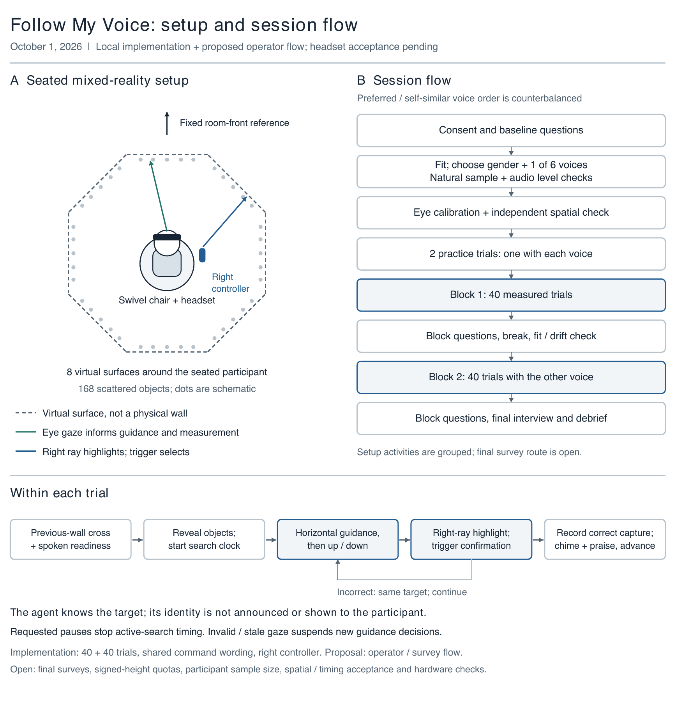

# Current system diagram export source

**October 1, 2026 — implemented runtime plus protocol proposal; hardware review pending.** This replaces the old table/dwell narrative. Existing historical diagram PDF/PNG exports are not current and were preserved.

Use the [current system diagram](diagram.md) for the editable Mermaid runtime/data flow and the [new setup/session figure](../resources/figures/follow-my-voice-study-flow-20261001.md) for vector PDF/SVG, PNG, caption, alt text and reproduction instructions. The new figure is a draft at full manuscript width; it is not a final approved study design.

The agent knows the hidden target and guides the seated participant horizontally and then vertically. The participant selects with the right controller ray and trigger. One separate practice using the first assigned voice precedes two counterbalanced 32-trial voice blocks. Both voices use shared command wording. Questionnaires and normal breaks occur outside active-search timing; immediate pauses remain available. Independent gaze validation, sensor-rate evidence, final survey choices and participant sample size remain open.
