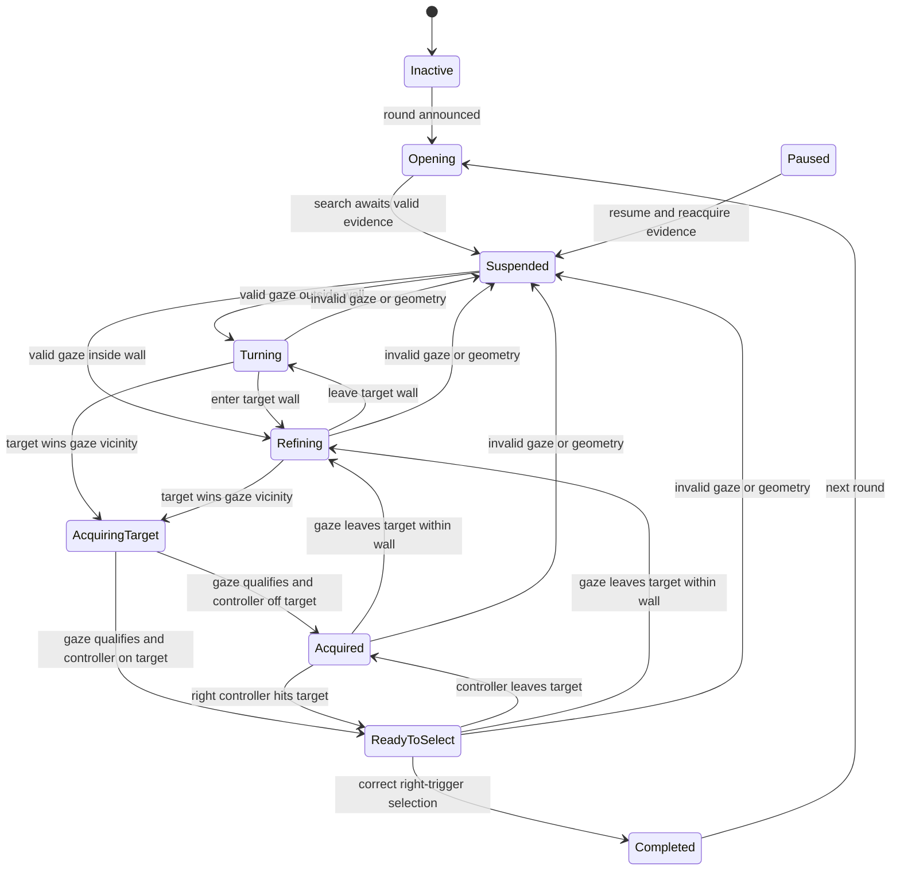
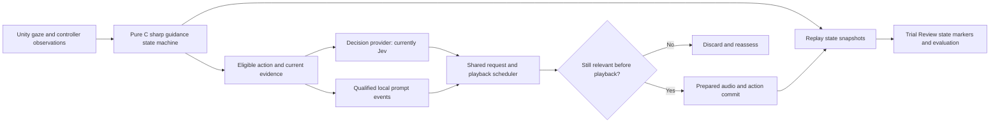

# Guidance state machine — implemented locally, October 20, 2026

The phase is recalculated from evidence; valid recovery can also enter AcquiringTarget directly. Any active search phase can pause, stop technically, or complete on a valid right-controller selection: selection does not require gaze confirmation. Paused, Stopped and Inactive are explicit lifecycle states. This diagram shows common paths, not every possible edge.

The state machine selects an allowed action separately from its phase. Looking confirmation needs 0.1 seconds; pointing confirmation needs a one-second controller hold with qualifying target gaze. A valid 0.15-second gaze departure rearms gaze confirmation; invalid tracking does not count as departure. Gate consumption happens only at actual software playback start. These are pilot interaction settings, not validated fixations.

Sources: Assets/GuidanceStateMachine.cs, Assets/HintGenerator*.cs, Assets/GuidanceRequestScheduler.cs, Assets/VoiceSynthesizer*.cs, and the Trial Review runtime. No automatic-evaluation score is a substitute for participant perception or validated sensor accuracy.
