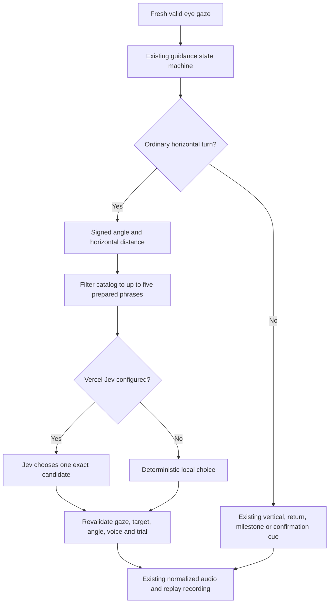
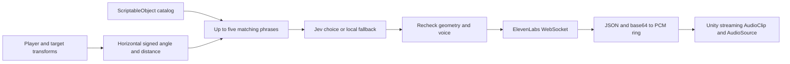

# Signed-angle navigation phrase pipeline

**Implemented (2026-10-10):** an editable 300-entry catalog, horizontal geometry filter,
TypeSafe Jev choice adapter, bounded ElevenLabs PCM WebSocket adapter, standalone Unity
coordinator, and a bridge into the existing study's calibrated playback path.
**Validation:** authenticated Jev through Vercel returned valid candidates in three synthetic desktop checks (1,357/214/213ms). A live ElevenLabs socket returned 22,291 PCM samples at 24kHz in 692ms for one short synthetic neutral line. These are desktop transport checks; headset listening and end-to-end latency remain pending. No claim of zero latency, validated optimal tone, or production readiness on the headset.

## How it fits this experiment



The study normally finishes a phrase and observes its audible gap. The v21 pilot permits bounded Jev-approved correction fades; see [speech scheduling](voice-guidance-states.md#speech-scheduling-and-evidence). It does not
request AI decisions every frame. A candidate is reconsidered only at a qualified
ordinary turn hint. A changed target, trial, voice, invalid gaze or arrival in the target
wall cancels pending selection. Final geometry must still fit the selected phrase.
Missing/unprepared catalog audio falls back to the existing directional cue; expired
requests are discarded, never queued for a later trial. At the rear seam (150–180°),
the existing route-lock logic retains control to prevent left/right oscillation.

0° is **relative to the supplied forward/gaze direction**, not absolute world forward.
The implementation projects origin, forward and target onto the horizontal XZ plane,
uses `Vector3.Distance`, then `Vector3.SignedAngle(forward, delta, Vector3.up)`.
Left is negative, right positive; exact rear is a ±180° seam. Zero horizontal separation
or a vertical forward vector is invalid. Distance does not authorize walking: all lines
are written for looking/turning while seated. A catalog match is not target confirmation.

## Files and authoring

- `Assets/SpatialVoice/NavigationPhraseDatabase.cs`: serializable phrase, Tone enum,
  ScriptableObject, validation and allocation-free O(n) filter with a caller-owned buffer.
- `Assets/Resources/SpatialVoice/NavigationPhrases.asset`: editable Inspector catalog.
- `Assets/Resources/SpatialVoice/navigation-phrases.json`: nested constraints/metadata
  exchange format. 15 angle bins × 5 distance bins × 4 tones = 300 distinct texts/IDs.
- `Assets/Editor/NavigationCatalogEditor.cs`: **Tools > Codex > Import Navigation Catalog**
  explicitly replaces the asset from JSON with Undo support after validating it.
- `scripts/generate-navigation-catalog.py`: initial draft generator; intentionally overwrites
  JSON only. Do not rerun over hand-edited phrases unless resetting that draft is intended.

Intervals are `[min,max)`, except the angular upper bound +180 is included. Thus -15,
+15, 1m, 2m, etc. belong to exactly one bin. Distance coverage is 0–10,000m; the actual
seated task occupies a small part of that range. Each bin has four tones. Custom
catalogs may return fewer candidates or none; the filter does not invent matches to
meet a count. Wraparound ranges must be split, e.g. [-180,-150) and [150,180].

The catalog adds pre-generation work. The study's normal full preparation includes it;
quick setup prepares the existing starter cues and fills the new catalog in the background.
No provider generation is performed by the catalog generator or offline tests.

## TypeSafe / Jev

`JevDecisionClient` posts to the documented `https://ai-gateway.vercel.sh/typesafe/v1/systemone`, using
Bearer auth, `model: typesafe-ai/jev`, a state string and
`questions.navigation_phrase = {type: choice, instructions, criteria}`. `criteria` maps
candidate **text** to structured tone, word-count and authored semantics. `answers.navigation_phrase.choice` must exactly
match an offered text; malformed or unoffered choices cannot become speech.

This differs from the requested `api.jev.ai/v1/decisions`/`choices` contract, which was
not substantiated in the vendor documentation. A 450ms total decision budget falls back
locally on missing credentials, provider error or timeout. Caller cancellation discards
selection altogether. Body size is bounded. State contains relative geometry and recent
wording, without participant IDs, recordings, target identity or raw eye traces.

The existing ignored local `api_keys.json` loader recognizes optional `jev_key` alongside
`elevenlabs_key`. Do not commit keys. Publicly distributed clients need a credential broker;
this project currently uses local researcher configuration. The user-provided `jev_key` was copied into the active checkout's ignored configuration, preserving existing keys. This is a Vercel Gateway credential: send it only to the verified Gateway endpoint, not directly to TypeSafe.

[Vercel TypeSafe compatibility API](https://vercel.com/docs/ai-gateway/sdks-and-apis/typesafe)

## Streaming entry point

`SpatialVoiceNavigationManager.TriggerNavigationVoiceHint(Transform target)` is the
requested async-void Unity entry point; `TriggerAsync` is awaitable. On a standalone
preview component, call `Configure(gatewayKey, elevenLabsKey, voiceIdProvider, database)`
from main-thread setup, set Player in the Inspector (or it uses `Camera.main`), then
trigger a target. Listen to `Diagnostic` and `PhraseSelected`. Do not run a second audio
owner alongside the study voice system. The study bridge configures its instance with
`allowStreaming: false`; it uses `ChooseAsync` and the established `VoiceSynthesizer`.

```csharp
var navigation = previewObject.AddComponent<SpatialVoice.SpatialVoiceNavigationManager>();
navigation.Configure(gatewayKey, elevenLabsKey, () => selectedVoiceId);
navigation.TriggerNavigationVoiceHint(target);
// On a scene/target cancellation:
navigation.Cancel();
```



The standalone preview uses `ClientWebSocket` with:

- `/v1/text-to-speech/{voice_id}/stream-input`
- `model_id=eleven_turbo_v2_5` (the current study model), `output_format=pcm_24000`, `auto_mode=true`.
- An initial space, then a complete phrase with trailing space, `try_trigger_generation`
  and `flush`, followed by empty-text EOS.
- Fragmented **JSON text frames**, base64-decoded to signed little-endian PCM16 mono,
  preserving a split sample byte between chunks. Both documented final-flag spellings
  are accepted. Provider errors, premature close, empty output and oversized frames fail.

The requested `eleven_turbo_v4` model identifier is not the existing verified TTS model.
An empty chunk schedule is not used as an undocumented workaround; `auto_mode` is the
vendor's complete-sentence option. Full predetermined text may be faster through HTTP
or cached clips than a new WebSocket handshake on every hint.

A bounded single-producer/single-consumer ring feeds a Unity streaming `AudioClip`.
Default prebuffer is 60ms (Inspector range 20–200ms), plus real network, synthesis and DSP
latency. Audio callbacks allocate nothing and take no locks. Underruns output silence and
are counted, not concealed. At most 30 seconds of PCM can be received; request timeout is
15 seconds for network activity, with a 35-second overall playback deadline. Disable/pause/focus loss cancels work. Concurrent trigger calls are dropped.
The short phrase finishes after audible onset; geometry is rechecked before playback.
DSP buffers are allowed to drain at completion so final syllables are not cut off.
Diagnostics report selection and request-to-play latency, which is **not** a measured
microphone-to-ear hardware latency.

**Open decision / validation gate:** streaming is a preview path. It does not currently
apply the study's whole-clip RMS matching, inner-thought treatment or exact replay clip
archive. Activating it during recorded study trials requires those contracts to be
preserved and verified first. The integrated study path retains all three today.

[ElevenLabs WebSocket reference](https://elevenlabs.io/docs/api-reference/text-to-speech/v-1-text-to-speech-voice-id-stream-input)

## Verification

- `bash scripts/test-spatial-voice.sh`: real adapters tested with fake transport frames;
  exact choice membership, TypeSafe payload, signed PCM, byte/frame fragmentation,
  ring wrap/overflow, producer-consumer ordering, underruns, close/error/cancellation.
- **Tools > Codex > Check Spatial Navigation**: actual Unity transforms and asset;
  exhaustive integer-angle coverage including ±180 and distance boundaries, finite/zero
  geometry, relative forward and exclusion of unprepared audio.
- Existing gaze-quality and voice-isolation regressions pass, as do refreshed Unity study-integration checks. Final Android build installed and launched on Vive on 2026-10-10; startup logs contain no matching fatal/navigation exceptions. This is startup verification, not a wearer guidance/streaming validation.
- On Vive: verify no wrong-direction audio after a rapid turn, no overlap with success or
  vertical cues, cancellation across trials, clone/neutral identity isolation, audible
  endings and measured streaming underruns/latency. The live smoke commands accept a path to ignored configuration: `bash scripts/test-spatial-voice.sh --live /path/to/api_keys.json` (three Jev decisions) or `--live-eleven` (one short synthetic neutral utterance). These incur provider usage and never print credential values.

### Structured speech semantics (v21, 2026-10-10)

**Implemented:** the 300 catalog entries now carry intent, horizontal/vertical axes,
magnitude, stage, interruption policy, prerequisites and superseding events. Geometry
still filters candidates locally; Jev chooses wording within that set. The same metadata
is serialized into the Inspector asset. `SpeechPhraseMetadata` also authors the meaning
of all 215 existing guidance texts; the editor importer exports these to
`Assets/Resources/SpatialVoice/guidance-phrase-semantics.json`. That export is a generated
reference; change the policy/metadata source and reimport to change these runtime cues.

Interruption state is a JSON object containing current/proposed phrase semantics,
playback context, current speech's starting stage, qualified event, and a compact current
gaze/geometry snapshot. `gazeAgeSeconds` is **receipt age**, not proof of sensor sampling
rate. No participant identifiers, raw eye trace or recordings are included. "Right area"
has no right-turn meaning unless its authored directional cue explicitly says right.

Unity protects unknown wording and `interruptPolicy=finish` locally. It also rejects
routine/progress events, redundant arrival after an instruction started within the target
wall, short onsets/endings, and obsolete approvals. Jev cannot override these guards.
Only verified arrival, overshoot/departure or acquisition events can ask for a correction.
The first 650ms and final 1s of speech are protected; effect tails do not extend speech.
Most short recorded phrases therefore finish naturally. Eligible approved corrections
retain the 150ms realtime fade (applied on Unity frames, not sample-accurate word boundaries).

**Implemented:** “A bit more.” and “Just a little more.” require the same direction,
at least 2° improvement since the previous instruction, no previous continuation in
that direction, and at most 10° remaining error. A vertical/diagonal cue additionally
requires at most 20% of the plane height. Stalling, reversal or a changed vertical band
uses an explicit direction. Outside-wall turn milestones keep their separate policy.
Both voice conditions use the same eligibility rules.

**Verification:** [scenario report](../testing/2026-10-10-jev-speech/report.md).
The final runs covered 43 synthetic scenarios × 3 calls = 129 requests: 117 completed
responses produced the expected effective behavior after local guards; 12 deadline
fallbacks finished the phrase. This does not mean Jev alone was always correct, nor does
it establish human naturalness or headset latency. Some test cases deliberately query
Jev despite a local veto, to test that the veto contains incorrect advice.

Commands (live modes incur provider usage; only use ignored local configuration):

```sh
bash scripts/test-spatial-voice.sh
bash scripts/test-spatial-voice.sh --scenario-suite /path/to/api_keys.json scripts/tests/jev-interruption-scenarios.json /tmp/jev-results.json 3
bash scripts/test-spatial-voice.sh --scenario-suite /path/to/api_keys.json scripts/tests/jev-interruption-holdouts.json /tmp/jev-additional.json 3
bash scripts/test-spatial-voice.sh --navigation-suite /path/to/api_keys.json /tmp/navigation-results.json
bash scripts/test-spatial-voice.sh --audition /path/to/api_keys.json /tmp/speech-audition
```

The file named `holdouts` contains additional scenarios that were used during tuning;
it is not an untouched evaluation set. Non-deadline effective mismatches fail the live
scenario command; timeouts are reported separately. Offline regression covers production
fade timing, stale results, protected semantics and near-target progress eligibility.

## End-of-round encouragement

**Implemented (2026-10-10):** a separate Jev `round_encouragement` choice selects one
prepared positive response after a correct trigger selection, in both voice conditions.
The existing success chime starts immediately; selection runs alongside it with a total
600ms decision limit. Missing keys, errors, malformed/out-of-set answers or deadline
expiry use an eligible prepared local response. No response can delay the next round
indefinitely. The captured voice ID/condition and presented trial identity are checked
again before playback. Stop/disable/restart/next-round presentation cancels pending work.
Final completion speech waits for this response; stopping the session cannot restart it.

`RoundPerformance` contains pause-excluded search duration, incorrect selection count,
actual guidance playback starts, repeat requests, practice status and (when available)
planned absolute target-wall turn angle. Search-start resets counters; guidance requests
that never play do not count as starts. Repeat requests include unavailable requests.
None of these values establish listening, reliance, workload, fixation quality or speed
relative to a baseline. Presented trial identity prevents reading the next round's index
when the game increments its objective before notifying completion subscribers.

`RoundEncouragement.Candidates` qualifies at most four prepared phrases locally, excluding
the previous response. Examples: “Nice work. You found it on your first selection.” only
with zero incorrect selections; “You found it. Nice recovery.” only after an incorrect
selection. At least 30 seconds of active search makes persistence wording eligible; this
is a conversational pilot threshold, not a validated difficulty/speed classification.
Unknown/nonfinite measurements allow only generic praise. Practice has a practice-specific
option. There are no participant comparisons, voice-condition comparisons, or claims that
the agent caused an improvement. The same candidate rules apply to both voice conditions.

All ten options are in quick/full preparation and use the study's normalized, identity-scoped
playback and replay audio. `round_encouragement_decision` records the frozen input facts,
phrase ID/text, selection/fallback status and policy version through the existing trial-event
and replay writers. Remote state excludes participant identity, raw gaze and voice identity.
These adaptations are implemented pilot behavior; wording/thresholds and effects on the study
remain subject to researcher review and wearer listening.

Verification: ten live synthetic Jev decisions (first-selection, recovery, long search,
practice, unavailable metrics, two successive responses each) returned eligible nonrepeating
choices in 194–528ms. Offline checks cover exact membership, wrong/unknown/nonfinite facts,
prepared-only filtering, HTTP contract and deadline cancellation. Unity integration checks
cover actual counters, paused search duration, presented identity, reset/cancellation and
both preparation paths. Run the live smoke with:

```sh
bash scripts/test-spatial-voice.sh --live-encouragement /path/to/api_keys.json
```


## Generated-audio verification and repair (2026-10-11)

**Implemented:** study audio preparation uses at most five concurrent download/verification
jobs. Voice identity and cache path are captured before each request; Unity clip decoding,
effects, RMS measurement and library admission remain sequential. Stopping or resetting
preparation cancels requests and prevents late results from entering the next library.

Every new clip and every legacy cache entry without a current receipt passes through
`VoiceAudioVerification`: ElevenLabs Scribe v2 transcribes the complete generated MP3
without the expected text as a hint. Verbatim mode retains fillers and audio-event tags.
The recognized words must match the approved script, allowing punctuation, listed
contractions, spelling variants and equivalent spoken numbers. Extra/missing words,
changed directions, filler words and reported non-speech events reject the clip.
See the [speech-to-text API](https://elevenlabs.io/docs/api-reference/speech-to-text/convert).

A mismatch triggers fresh synthesis and another verification, with at most three new
synthesis attempts. Exhausted retries or unavailable verification keep the clip out of
playback; they never authorize unchecked audio. A failed required starter prevents setup
completion; optional background failures leave that phrase unavailable. Known-bad MP3s
are quarantined by exact hash, and scripted fillers are rejected before synthesis.

Each accepted MP3 gets a `.verified.json` receipt containing policy version, exact script,
recognized transcript, audio SHA-256 and verification time. Subsequent cache use checks
that receipt against the current bytes and script, avoiding another provider call. The
run's voice-library manifest also records the verification version and source hash.
Verification adds first-preparation latency and provider usage for both voice conditions;
prepared playback remains local. Rejection/pass events enter audio telemetry.

**Verification:** fake-transport tests cover concurrency, cancellation, identity isolation,
HTTP failures, transcript mismatches, bounded regeneration, receipt tampering and legacy
cache admission. Live Scribe testing rejected the reported corrupt neutral clip and
accepted both replacement clips. A local Whisper pass flagged 56 of 528 clips for review;
these are mismatch flags, not 56 confirmed bad recordings. Two original clips showed
unwanted trailing speech. ASR can still miss artifacts or falsely reject good speech;
wearer listening remains necessary. `scripts/voice-prep/audit_cached_voice.py` provides
an optional local audit and does not mutate audio or issue playback receipts.


## Shared Jev runtime context (2026-10-11)

**Implemented:** ordinary catalog selection and interruption advice now receive the
same structured gameplay evidence plus a snapshot of actual AudioSource playback.
Previously only interruption advice got the compact gaze/area evidence; catalog choice
received yaw, distance, tone and last catalog phrase in prose.

| State | Meaning |
| --- | --- |
| Gaze/controller ray hit | Target, distractor, non-object, none, or unavailable; exact gaze ray hits remain separate from vicinity acceptance. |
| Target area | Current inside-wall status and completed stable wall-entry gate. |
| Target vicinity | Unique target winner, angular error/radius, candidate count and ambiguity. |
| Completed holds | Target gaze meets 0.1s; controller-on-target meets 1s; wall entry meets 0.25s. Immediate hits do not imply completed holds. |
| Controller | Fresh tracking evidence, target intersection, trigger held (0/1, -1 unknown) and telemetry age. |
| Gaze/geometry | Input-delivery and receipt ages, snapshot time, validity, yaw/pitch error and measured vertical plane fraction. Missing geometry is null. |
| Recent guidance | Previous direction, continuation already used, target acknowledged, recent target-visit age and pending return cue. |
| Speech | Is speaking/busy, current and pending phrase, last spoken phrase, semantic metadata, context, start stage, elapsed/remaining speech seconds and fade in progress. |

The evidence buffer updates after the current tick's hold gates. Serialized copies are
frozen before asynchronous requests, carry capture/sample ages, and are recorded in
navigation/interruption telemetry. Pausing/cancelling or starting another objective clears
old gameplay evidence. Missing input is unknown; a tracking gap is not evidence of a miss.

Jev receives snapshots when a decision is requested, not a new network request every
frame. Existing candidate eligibility, deadlines, direction checks and revalidation before
playback/fade remain authoritative. Catalog choice still serves coarse horizontal guidance;
local logic selects within-wall directions and qualifies confirmations. Round encouragement
continues to use its separate completed-round performance snapshot. No participant IDs,
voice identity or raw gaze time series are added to the Jev payload.

**Verification:** offline contract/playback tests cover immutable state, unknown geometry,
actual active speech and JSON transport. Unity integration checks cover target versus
distractor intersections, incomplete/completed holds, lost tracking and trial cancellation.
These checks establish correct state delivery, not improved perceived conversational quality.


## Directional continuation wording (2026-10-11)

**Implemented:** turn milestones now say “Keep going to the left/right,” “That's it,
keep going left/right,” or “Keep going left/right.” Within-wall continuation uses
“Keep looking up/down” and the corresponding up/down-and-left/right combinations.
The direction comes from the current validated, route-locked guidance category.
Directionless “Keep going,” “Keep going that way,” and “That's it, keep turning”
are no longer in the prepared guidance library. Existing milestone/cadence and
one-continuation limits remain; the small-progress “A bit more” alternatives remain.
Jev phrase metadata and the generated semantics export include the explicit axes.
New wording is generated and verified by normal audio preparation for both voices.

### Audio repair after a wording mismatch (2026-10-11)

**Implemented:** setup still requires a verified clip for every required phrase. The first synthesis request keeps its existing settings. The second and third attempts spell integer angles and request English with stability 0.85 and 1.0 respectively; the final attempt disables speaker boost. Both voice conditions use the same policy and retain their selected ElevenLabs voice and Turbo v2.5 model. Each result must pass the original exact-word/filler checks; an exhausted repair identifies the phrase instead of reporting an unexplained generic failure. This reduces repeated bad generations without allowing unchecked audio into trials.

The request settings follow [ElevenLabs voice settings documentation](https://elevenlabs.io/docs/speech-synthesis/voice-settings). The specific repair values are an engineering choice tested on the two failing Eric clips, not a guarantee for every voice.

### Faster pilot cadence (2026-10-11)

**Implemented:** ordinary hints become eligible at 0.6-second intervals, with a 0.25-second pause after ordinary speech and 0.6 seconds after confirmations. Direction/wall-entry qualification uses 0.25 seconds; Jev decides when another stalled-turn reminder is useful (without an advisor, reminders wait 3 seconds). Catalog wording selection waits up to 450 ms for Jev before using the existing prepared local fallback. These gates overlap rather than forming a guaranteed total response time, and actual phrase length still matters. Both voice conditions use the same pacing. Playback speed and interruption/validity protections are unchanged; headset pilot testing should check responsiveness and boundary chatter.


**Implemented: Jev transmission decision.** Idle automatic guidance passes the proposed prepared phrase, current gaze/controller evidence and actual playback history to a typed `transmit` decision (`speak`/`wait`). The deadline is 400 ms, with one request in flight. Wait defers the same reason for 0.6 seconds; only an actual speech commitment updates variant counts, hint history and turn milestones. Target geometry, catalog bounds, gaze validity, round lifecycle and voice identity are rechecked before playback. Late approvals are discarded. Provider failure/timeout falls back to the still-valid prepared local cue and is recorded explicitly in `transmission_decision` telemetry. The 0.6-second interval is therefore eligibility, not guaranteed audio onset.

While audio is playing, the separate protected Jev interruption decision remains active: an approved fresh correction fades over 150 ms, while unavailable/late advice lets the phrase finish. Explicit repeat requests, setup, mandatory opening cues and success feedback keep their existing lifecycle. Both decisions retain local validity and semantic safeguards.


**October 11 silence fix (pilot):** pending transmission advice is reported separately from actual busy playback. The prompt treats a qualified new direction or more than three seconds of silence as actionable. Repeated Jev wait decisions are bounded to three seconds from the first deferral before a still-valid prepared cue can use `local_fallback_deferral_limit`; cancellation resets that budget. This is a liveness safeguard, not permission to speak through invalid gaze or override interruption protections.

### Implemented: joint coarse-guidance decision (October 11)

The study bridge now submits two typed questions, `navigation_phrase` and `transmit`, in one request for eligible coarse turns. The selected phrase still must match current geometry and a prepared clip. Its speak/wait answer enters the ordinary transmission gate without another API call. Unknown/missing answers or a deadline use the existing local fallback; a single eligible candidate uses the separate transmission advisor. Fine guidance retains the separate speak/wait request, and interruption advice remains independent and protected.

The combined call keeps the 450 ms catalog deadline. A synthetic asynchronous connection warm-up runs once when the voice library becomes ready, with a 1.5-second cap and no participant data or playback side effects. Joint catalog and transmission telemetry identify `advice_path=joint_catalog`; count this as one API request, not two. `selection_ms` measures catalog selection through the response; downstream transmission `elapsed_ms` measures only local acceptance for the joint path.

Desktop synthetic measurements and limitations are recorded in `docs/testing/2026-10-11-jev-latency/README.md`. The measured latency improvement is not evidence of a new headset failure rate until another hardware session is recorded.

### Implemented: completion feedback context (October 11)

The completion event now explicitly identifies `round_complete`, `post_selection_feedback`, the successful right-controller trigger selection, and `search_finished=true`. The snapshot adds the presented trial number, block/trial-in-block when blocks apply, and the previous feedback. Existing timing/error/instruction/repeat/turn data remain. Jev chooses a prepared line from the 13-line catalog while the success chime plays; the phrase still belongs to the completed trial and voice.

Three quick-find lines (for example, “That was quick! You selected the right object.”) are locally eligible only for positive active search duration at most 10 seconds, zero incorrect selections, and a measured non-practice trial. `RoundEncouragement.QuickSearchSeconds` is an implemented pilot wording threshold, not a validated speed norm or comparison between participants/conditions. Completion responses do not give new search directions or claim the entire study is finished. The 600 ms request deadline and local fallback are unchanged. New/revised clips pass the existing voice preparation and verification pipeline for each selected voice.

### Implemented — five-option inspection (October 12, 2026)

The navigation catalog has 375 entries, including a fifth wording alternative per angle/distance bin. Selection first preserves tone diversity, then fills up to five distinct prepared phrases. Fewer prepared clips yield fewer candidates; no geometry bounds are widened. Completion praise keeps its separate eligibility filter.

`jev_trace` replay events carry request IDs, state, candidate metadata, accepted provider answers/probabilities, elapsed time and transport outcome. Guidance/encouragement IDs link the request to application decisions and recorded audio onset. These are software events, not evidence of listening. Credentials and headers are excluded. Trial Review shows this evidence in a dedicated Jev lane/tab; old runs retain unknowns. Model probability is not a validated navigation-accuracy score.
