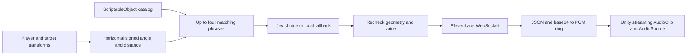

# Signed-angle navigation phrase pipeline

**Implemented (2026-10-10):** an editable 300-entry catalog, horizontal geometry filter,
TypeSafe Jev choice adapter, bounded ElevenLabs PCM WebSocket adapter, standalone Unity
coordinator, and a bridge into the existing study's calibrated playback path.
**Validation:** authenticated Jev through Vercel returned valid candidates in three synthetic desktop checks (1,357/214/213ms). A live ElevenLabs socket returned 22,291 PCM samples at 24kHz in 692ms for one short synthetic neutral line. These are desktop transport checks; headset listening and end-to-end latency remain pending. No claim of zero latency, validated optimal tone, or production readiness on the headset.

## How it fits this experiment


The study normally finishes a phrase and observes its audible gap. The v20 pilot permits bounded Jev-approved correction fades; see [speech scheduling](voice-guidance-states.md#speech-scheduling-and-evidence). It does not
request AI decisions every frame. A candidate is reconsidered only at a qualified
ordinary turn hint. A changed target, trial, voice, invalid gaze or arrival in the target
wall cancels pending selection. Final geometry must still fit the selected phrase.
Missing/unprepared catalog audio falls back to the existing directional cue; expired
requests are discarded, never queued for a later trial. At the rear seam (150–180°),
the existing route-lock logic retains control to prevent left/right oscillation.

0° is **relative to the supplied forward/gaze direction**, not absolute world forward.
The implementation projects origin, forward and target onto the horizontal XZ plane,
uses `Vector3.Distance`, then `Vector3.SignedAngle(forward, delta, Vector3.up)`.
Left is negative, right positive; exact rear is a ±180° seam. Zero horizontal separation
or a vertical forward vector is invalid. Distance does not authorize walking: all lines
are written for looking/turning while seated. A catalog match is not target confirmation.

## Files and authoring

- `Assets/SpatialVoice/NavigationPhraseDatabase.cs`: serializable phrase, Tone enum,
  ScriptableObject, validation and allocation-free O(n) filter with a caller-owned buffer.
- `Assets/Resources/SpatialVoice/NavigationPhrases.asset`: editable Inspector catalog.
- `Assets/Resources/SpatialVoice/navigation-phrases.json`: nested constraints/metadata
  exchange format. 15 angle bins × 5 distance bins × 4 tones = 300 distinct texts/IDs.
- `Assets/Editor/NavigationCatalogEditor.cs`: **Tools > Codex > Import Navigation Catalog**
  explicitly replaces the asset from JSON with Undo support after validating it.
- `scripts/generate-navigation-catalog.py`: initial draft generator; intentionally overwrites
  JSON only. Do not rerun over hand-edited phrases unless resetting that draft is intended.

Intervals are `[min,max)`, except the angular upper bound +180 is included. Thus -15,
+15, 1m, 2m, etc. belong to exactly one bin. Distance coverage is 0–10,000m; the actual
seated task occupies a small part of that range. Each bin has four tones. Custom
catalogs may return fewer candidates or none; the filter does not invent matches to
meet a count. Wraparound ranges must be split, e.g. [-180,-150) and [150,180].

The catalog adds pre-generation work. The study's normal full preparation includes it;
quick setup prepares the existing starter cues and fills the new catalog in the background.
No provider generation is performed by the catalog generator or offline tests.

## TypeSafe / Jev

`JevDecisionClient` posts to the documented `https://ai-gateway.vercel.sh/typesafe/v1/systemone`, using
Bearer auth, `model: typesafe-ai/jev`, a state string and
`questions.navigation_phrase = {type: choice, instructions, criteria}`. `criteria` maps
candidate **text** to tone descriptions. `answers.navigation_phrase.choice` must exactly
match an offered text; malformed or unoffered choices cannot become speech.

This differs from the requested `api.jev.ai/v1/decisions`/`choices` contract, which was
not substantiated in the vendor documentation. A 900ms total decision budget falls back
locally on missing credentials, provider error or timeout. Caller cancellation discards
selection altogether. Body size is bounded. State contains relative geometry and recent
wording, without participant IDs, recordings, target identity or raw eye traces.

The existing ignored local `api_keys.json` loader recognizes optional `jev_key` alongside
`elevenlabs_key`. Do not commit keys. Publicly distributed clients need a credential broker;
this project currently uses local researcher configuration. The user-provided `jev_key` was copied into the active checkout's ignored configuration, preserving existing keys. This is a Vercel Gateway credential: send it only to the verified Gateway endpoint, not directly to TypeSafe.

[Vercel TypeSafe compatibility API](https://vercel.com/docs/ai-gateway/sdks-and-apis/typesafe)

## Streaming entry point

`SpatialVoiceNavigationManager.TriggerNavigationVoiceHint(Transform target)` is the
requested async-void Unity entry point; `TriggerAsync` is awaitable. On a standalone
preview component, call `Configure(gatewayKey, elevenLabsKey, voiceIdProvider, database)`
from main-thread setup, set Player in the Inspector (or it uses `Camera.main`), then
trigger a target. Listen to `Diagnostic` and `PhraseSelected`. Do not run a second audio
owner alongside the study voice system. The study bridge configures its instance with
`allowStreaming: false`; it uses `ChooseAsync` and the established `VoiceSynthesizer`.

```csharp
var navigation = previewObject.AddComponent<SpatialVoice.SpatialVoiceNavigationManager>();
navigation.Configure(gatewayKey, elevenLabsKey, () => selectedVoiceId);
navigation.TriggerNavigationVoiceHint(target);
// On a scene/target cancellation:
navigation.Cancel();
```



The standalone preview uses `ClientWebSocket` with:

- `/v1/text-to-speech/{voice_id}/stream-input`
- `model_id=eleven_turbo_v2_5` (the current study model), `output_format=pcm_24000`, `auto_mode=true`.
- An initial space, then a complete phrase with trailing space, `try_trigger_generation`
  and `flush`, followed by empty-text EOS.
- Fragmented **JSON text frames**, base64-decoded to signed little-endian PCM16 mono,
  preserving a split sample byte between chunks. Both documented final-flag spellings
  are accepted. Provider errors, premature close, empty output and oversized frames fail.

The requested `eleven_turbo_v4` model identifier is not the existing verified TTS model.
An empty chunk schedule is not used as an undocumented workaround; `auto_mode` is the
vendor's complete-sentence option. Full predetermined text may be faster through HTTP
or cached clips than a new WebSocket handshake on every hint.

A bounded single-producer/single-consumer ring feeds a Unity streaming `AudioClip`.
Default prebuffer is 60ms (Inspector range 20–200ms), plus real network, synthesis and DSP
latency. Audio callbacks allocate nothing and take no locks. Underruns output silence and
are counted, not concealed. At most 30 seconds of PCM can be received; request timeout is
15 seconds for network activity, with a 35-second overall playback deadline. Disable/pause/focus loss cancels work. Concurrent trigger calls are dropped.
The short phrase finishes after audible onset; geometry is rechecked before playback.
DSP buffers are allowed to drain at completion so final syllables are not cut off.
Diagnostics report selection and request-to-play latency, which is **not** a measured
microphone-to-ear hardware latency.

**Open decision / validation gate:** streaming is a preview path. It does not currently
apply the study's whole-clip RMS matching, inner-thought treatment or exact replay clip
archive. Activating it during recorded study trials requires those contracts to be
preserved and verified first. The integrated study path retains all three today.

[ElevenLabs WebSocket reference](https://elevenlabs.io/docs/api-reference/text-to-speech/v-1-text-to-speech-voice-id-stream-input)

## Verification

- `bash scripts/test-spatial-voice.sh`: real adapters tested with fake transport frames;
  exact choice membership, TypeSafe payload, signed PCM, byte/frame fragmentation,
  ring wrap/overflow, producer-consumer ordering, underruns, close/error/cancellation.
- **Tools > Codex > Check Spatial Navigation**: actual Unity transforms and asset;
  exhaustive integer-angle coverage including ±180 and distance boundaries, finite/zero
  geometry, relative forward and exclusion of unprepared audio.
- Existing gaze-quality and voice-isolation regressions pass, as do refreshed Unity study-integration checks. Final Android build installed and launched on Vive on 2026-10-10; startup logs contain no matching fatal/navigation exceptions. This is startup verification, not a wearer guidance/streaming validation.
- On Vive: verify no wrong-direction audio after a rapid turn, no overlap with success or
  vertical cues, cancellation across trials, clone/neutral identity isolation, audible
  endings and measured streaming underruns/latency. The live smoke commands accept a path to ignored configuration: `bash scripts/test-spatial-voice.sh --live /path/to/api_keys.json` (three Jev decisions) or `--live-eleven` (one short synthetic neutral utterance). These incur provider usage and never print credential values.

### Interruption pilot evidence (2026-10-10)

**Implemented:** `ShouldInterruptAsync` uses a separate typed `speech_action` choice (`finish_phrase` / `fade_out`) through the same gateway. The synthesizer owns the live-state, single-request, freshness and local timing guards. `--live-interruption /path/to/api_keys.json` warms the shared client then runs four synthetic cases. Jev approved stable wall arrival and opposite-direction overshoot, rejected equivalent wording and brief jitter; measured calls were 247/243/199/175ms. This is a small transport/decision smoke test, not validation of human conversational naturalness or phoneme boundaries.
