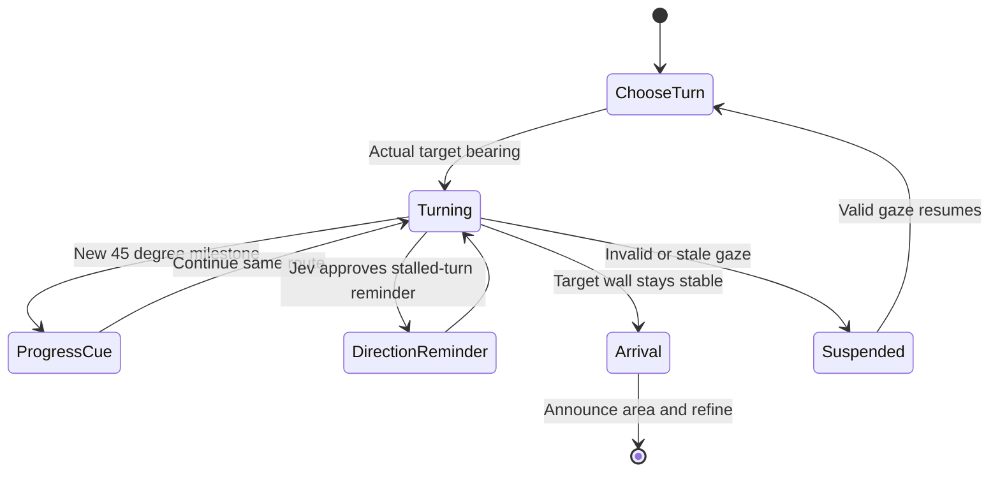
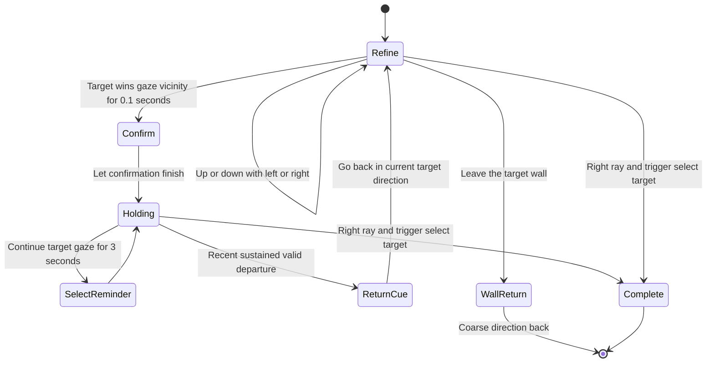
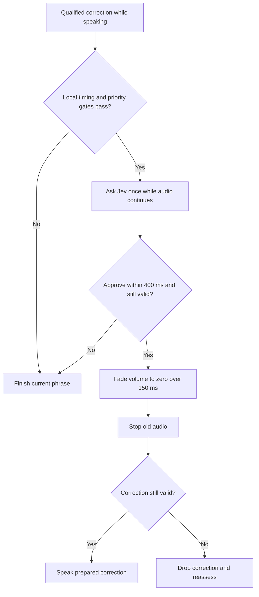

# Conversational voice guidance

**Implemented locally, October 20, 2026 — v25.** Headset wearer validation remains necessary; durations and tolerances are pilot interaction settings, not validated fixations or perceptual thresholds.

The opening direction plays before the objects appear and before search timing starts. The target remains hidden from the participant. Both voice conditions use the same guidance decisions and phrase library.

**Implemented October 20:** [central guidance-state architecture](central-guidance-state-machine.md) now owns the qualification gates, action priority, recent-turn/target history and lifecycle transitions. `HintGenerator` remains the Unity adapter, split into observation and state/telemetry partial files while preserving its scene component identity. An injected `INavigationDecisionProvider` supplies conversational advice (Jev by default), and a shared `GuidanceRequestScheduler` owns pending request scopes and the unsounded cue. State changes cancel stale pending work; final geometry is checked immediately before audio starts, and gates are consumed only at actual playback. Already-playing audio still follows the established interruption policy.

Replay and Jev receive the same `GuidanceStateSnapshot`. Trial Review distinguishes direct gaze hit, nearest vicinity winner and right-controller hit. Historical recordings do not receive inferred central phases. Non-spatial lifecycle states remain inspectable when pose sampling stops, while spatial markers still require a fresh sample.

## Outside the target wall

- Actual object position determines shortest left/right direction, including its lateral offset on the wall. An exact seated-layout 0-to-180 tie chooses right; 180-to-0 chooses left. Near the rear seam, retain the opening/initial route until the remaining angle is below 150 degrees or the target wall is entered. This prevents +/-180 jitter reversing the instruction.
- At 90 degrees or more remaining, say “Turn way left/right.” Each newly reached 45-degree remaining-error milestone can produce one varied continuation: “Keep going to the right,” “That's it, keep going right,” or “Keep going right” (with matching leftward variants). Repeated crossings of a consumed milestone do not rearm it. Fast movement coalesces milestones instead of queueing stale cues.
- Cues wait for available speech and the 0.1-second ordinary interval. New milestones, stable arrivals and qualified return corrections use a local prepared phrase, without a second Jev speak/wait decision. Jev still advises ordinary directions, with a one-second maximum transmission deferral. A reminder with the same semantic direction/magnitude waits three seconds after the preceding directional clip ends, including on timeout; actual direction changes and new milestones remain eligible. These gates mean no promise to speak at every wall boundary during a fast turn.
- Stable arrival combines an area acknowledgment and the current refinement in one prepared clip. A recent wall departure gives the actual direction back rather than generic “go back.”

## Inside the target wall

Vertical wording uses the actual ray intersection height on the target wall: at most 20% of wall height is “a little”; above 20% through 50% is ordinary “higher/lower”; above 50% is “way higher/lower.” Diagonals combine the required axes. Looking vertically within a wall does not itself count as leaving the area.

A recent target-winning gaze visit lasting at least 0.1 seconds arms departure memory. A continuous valid departure of at least 0.25 seconds permits “Go back down and left,” using current geometry. The memory expires two seconds after departure, has a six-second spoken-cue cooldown, and clears on invalid gaze or lifecycle reset. Returning to the target cancels a pending departure cue. This supplements the existing narrower observed-bearing-crossing history; it does not prove the person perceived the object.

Target confirmation still requires the target to be the unique closest candidate among overlapping vicinities. A fresh exact right-controller hit held for one second plus target-winning gaze can say “You're on it!” A valid 0.15-second look-away rearms gaze confirmation; returning requires another 0.1-second hold. Blinks do not count as look-away. Continuous holding gets the once-per-trial trigger reminder instead of repeated confirmations. When the right controller already hits the target, say “Press the right trigger to select it”; otherwise include aiming. Recheck controller state before speaking. Qualified confirmations/reminders skip idle transmission advice but retain current evidence and playback gates.

## Speech scheduling and evidence

**Implemented v20 (pilot):** ordinary guidance still finishes before the next cue. A stable area-entry, return, overshoot or target-confirmation correction can now ask Jev in parallel whether an unfinished direction has become misleading. At most one request is made per utterance, with a 400ms budget. The current audio continues while the request is pending. Missing keys, errors, a finish decision, expired answers or changed evidence retain finish-phrase behavior. No network request is sent on every gaze tick.

Local rules protect the first 650ms, the last 1,000ms of the recorded speech window (excluding the clone's effect tail), acknowledgments and the trigger reminder; interruptions have a 2.5-second cooldown. Every request needs prepared replacement audio and valid qualified gaze. Only current approval can start a linear fade from the current volume to zero over a nominal **150ms of unscaled real time**, then stop. Unity applies volume per frame, so the stop occurs on the first frame at or after the deadline, not a sample-accurate 150ms guarantee. After fading, recheck the correction; drop it if gaze/target evidence changed. Do not reverse the fade partway through.

The October 20 post-sentence gap is 0.25 seconds, or 0.1 seconds after acknowledgments. Invalid gaze suspends new decisions immediately; after the existing 250ms tracking grace, current guidance fades out locally without consulting Jev. Pause, trial cancellation, setup/opening cancellation and disabling the component retain immediate stop semantics.

The pilot is controlled by **Use Jev Interruptions** on `VoiceSynthesizer` in the Inspector (enabled by default). Turning it off restores finish-phrase correction scheduling; tracking-loss fade remains. Both voice conditions share the same policy. `interruption_advice` logs decisions/discards and `audio_fade_start` records the 150ms envelope for reconstruction. Existing installed standalone replay viewers need rebuilding to gain the new envelope renderer.

Examples are shortened to “Turn way left,” “Right area. Look lower,” “Go back down and left,” and “Aim at it with your right controller and press the trigger.” Vertical distance tiers and both voice conditions retain the same decision rules.

| Awkward transition | Evaluation | Current behavior |
| --- | --- | --- |
| Go back — YEP | Cuts off the return instruction | Usually finish; a current Jev approval may fade a misleading long return, then revalidate confirmation |
| YEP — now look down | Gives contradictory-sounding instructions too rapidly | Finish acknowledgment and wait 0.1 seconds before reevaluating |
| Up — down — up during gaze motion | Speaks transient states | Finish one phrase; choose only the latest stable direction |
| Blink cuts a word | Treats a short data gap as a speech cancellation | Immediately suspend new decisions; allow 0.25 seconds before fading current speech |

Pause, completion and session cancellation still stop speech immediately. Sustained invalid tracking stops it after the 0.25-second grace period. Raw invalid samples and gaps remain recorded; no head-gaze fallback or new invalid-gaze decision is introduced. These are pilot conversational settings, and naturalness requires wearer listening.

Decision events distinguish `turn_progress_milestone`, `recent_target_departure`, wall arrival/exit and narrow target-bearing overshoot. They include actual target yaw/pitch, planned remaining turn degrees, vertical metres/fraction, latest qualified target-visit receipt time and eye-observation sequence, plus existing gaze source IDs. Original eye observations are preserved.

**Wearer checks:** 0-to-180 and 180-to-0 turns; targets on either side of the opposite wall; stop/backtrack across a milestone; enter high/low targets; look at the target then away diagonally; overshoot the wall; blink; reacquire; select with the right trigger. Listen for false direction reversals, repeated progress messages and truncated speech.

### v21 semantic and continuation refinements

**Implemented:** structured phrase meaning now accompanies Jev decisions. Unknown phrases
and finish-only metadata cannot be interrupted; ordinary progress cues and a redundant
same-wall arrival cannot request an interruption. See [the semantic pipeline](spatial-voice-navigation.md#structured-speech-semantics-v21-2026-10-10).

Within the wall, “A bit more” / “Just a little more” can follow a direction only after
at least 2° of improvement, with at most 10° remaining and, for vertical/diagonal guidance,
at most 20% plane-height error. One continuation per unchanged direction prevents a loop.

### Short turn-progress cues (October 20)

**Implemented:** new 45-degree turn milestones can use “More, more.”, “Keep turning.” or “A bit further.” when a direction was explicitly spoken within six seconds and valid gaze shows at least two degrees of recent progress on that route. Progress evidence expires after 350 ms; an observed reversal greater than 0.5 degrees invalidates it immediately. Tracking gaps clear motion evidence; invalid gaze also clears the explicit-direction context. The cue is checked again immediately before playback. Otherwise the milestone names the direction. Milestones still consume only at playback, so backtracking or standing still cannot repeat one. These are pilot conversation thresholds, not fixation measures.
