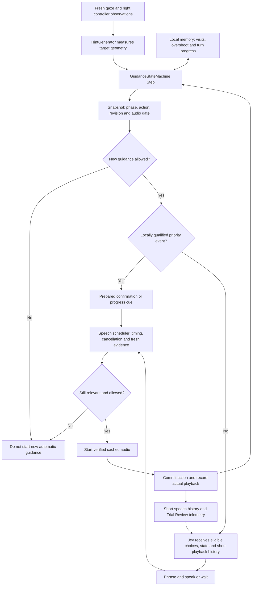
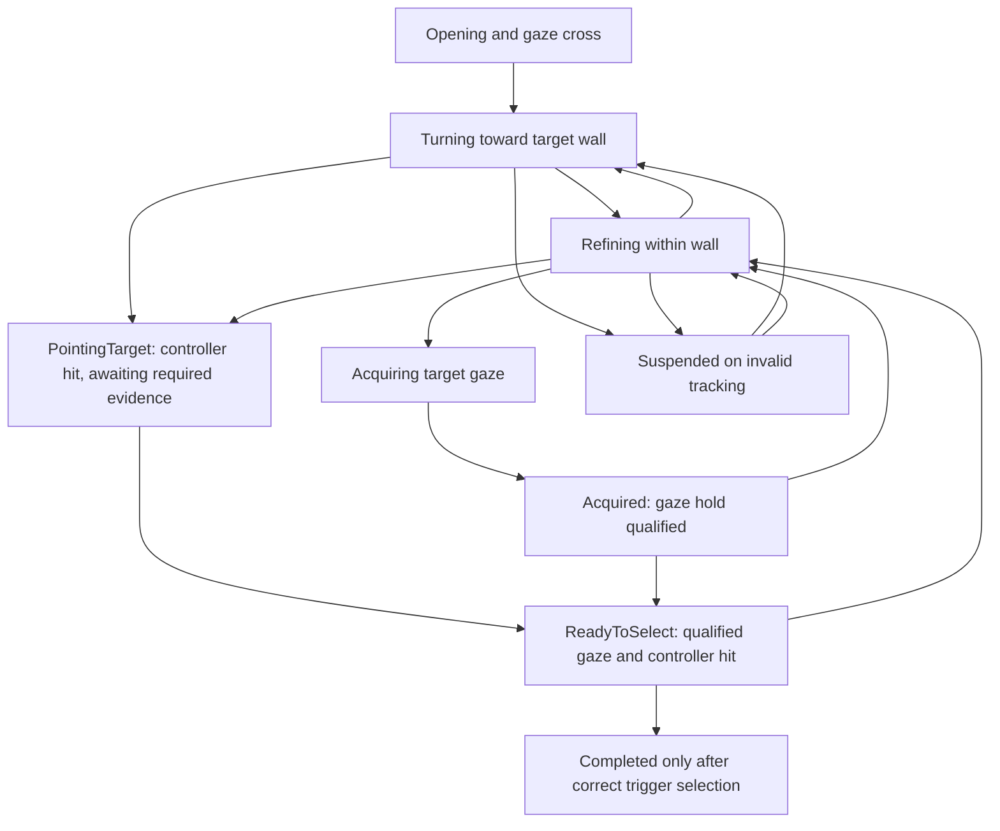

# Jev payload audit and bounded memory

## Implemented

The runtime sends a frozen snapshot, not an ongoing chat session. Jev does not
automatically remember earlier calls. Before this change it received memory
summaries (previous direction/phase, recent target visit, acknowledgment,
continuation, last spoken phrase), but no chronological speech history.

`SpeechDecisionMemory` now supplies up to four actual software playback starts
and four phase transitions from the last 15 seconds. Each speech entry contains
its text, age, phase/action at start and outcome: started, completed or interrupted.
No proposed/queued line is inserted as spoken. Interrupted does not mean the
listener heard the entire phrase. Resetting guidance, including new objectives
and cancellation, clears this memory. Async requests receive detached snapshots.

The raw gaze-history buffer remains local. `GazeTargetHistory` detects recent
target visits/crossings; `GuidanceTurnState` tracks route lock and progress.
Those are geometry calculations, not Jev's inferred recollection of the user.

The joint request factors exactly equal candidate semantic fields into
`candidate_semantics_defaults`. Each candidate retains its differences.
Reconstruction tests verify semantic equality; current evidence is unchanged.
The ordinary path still offers two to five locally eligible phrases, with
phrase choice and speak/wait in one request. This is not deployment of the
experimental unfiltered/all-Jev action menu.

The central state snapshot now explicitly exposes `newGuidanceAllowed`. It is
true only for valid gaze and an eligible action. Unity checks it before ordinary
guidance requests, on transmission completion and before queued playback.
Existing relevance callbacks still check current geometry, target, controller
evidence and revision. This flag governs new automatic guidance, not setup,
success audio or explicit repeat requests. Closing it does not automatically
interrupt current speech. Existing local suppression and interruption rules
remain separate.

## Ownership and flow

`FindObjectGameManager` owns round lifecycle and successful trigger selection.
`GuidanceStateMachine` is the source of truth for guidance phase, qualification
and eligible action. `GuidanceRequestScheduler` owns pending request cancellation
and queued playback; `VoiceSynthesizer` owns the AudioSource and speech timing.
They are separate responsibilities, not one enormous state machine.

This is a simplified navigation diagram, not an exhaustive transition table.
Phase and allowed action are distinct: `ReadyToSelect` alone does not prove a
one-second controller hold. Gaze confirmation needs the 0.1-second gaze
qualification; pointing confirmation needs the separate one-second controller
hold plus valid gaze nearby. A controller hit suppresses search directions
immediately, even before it qualifies for confirmation.

## Earlier four-policy comparison: corrected interpretation

The earlier pilot made 314 real Mac HTTP requests across 416 decisions
(102 local). It used 36 scripted frames and 16 recorded probes, repeated twice.
It was a Python approximation, not the Unity state machine and scheduler.
Histories were frozen and shared: hypothetical earlier outputs did not feed the
next request. The recorded probes lacked some qualifier fields and were unscored.

| Policy | HTTP median | HTTP p95 | Clearly opposing direction in scripted requests |
|---|---:|---:|---:|
| Current-style | 233 ms | 372 ms | 0 |
| Broader eligible actions | 229 ms | 419 ms | 0 |
| All Jev | 234 ms | 372 ms | 1 |
| Jev with local overrides | 238 ms | 359 ms | 0 |

The one clear case was `large_turn_entry_2`: current yaw +45 degrees, preceding
observations +150 then +90, yet Jev chose `orient_left` in one repetition.
The other repetition chose wait. This supports a request-relative direction
error, not a claim about what was spoken in the headset.

The original strict expected-action rubric overflagged useful alternatives.
A trigger reminder can help instead of a pointing acknowledgment, and a partial
horizontal direction can help instead of a diagonal. Those are no longer labeled
wrong merely for differing from the reference policy. Repeated/unsupported
reminders and missing context remain separate from counterproductive directions.
Waits are opportunities to review, not automatically harmful silence episodes.
Unknown remains unknown; Astra judgments remain advisory.

Original requests/results remain intact. Revised evidence flags are in
`analysis/pilots/20261020-four-policy/helpfulness-summary.json`. They are not
human-perceived correctness or demonstrated participant improvement.

## Measurement procedure

`scripts/test-spatial-voice.sh --export-memory-probes <file>` exports synthetic
requests from the actual production C# builder. `analysis/jev_payload_pilot.py`
alternates the baseline, compact-only and compact-with-memory forms, saving the
exact outgoing payloads and typed choices. All offered phrases point in the same
valid direction; any offered phrase is accepted. Checks concern explicit
speaking/validity gates, not a preferred wording.

HTTP timing is measured on the Mac. The probe timeout is three seconds, and
responses beyond the runtime's 450 ms budget are reported separately. No audio
is generated or played by this experiment. It cannot establish acoustic latency,
headset responsiveness, or whether the participant found a phrase helpful.

The first 48-request batch reduced median size from 5,454 to 5,021 bytes with
memory included, but median HTTP time increased from 142 to 156 ms. This is
evidence for denser context, not speed. All three forms missed the busy-but-not-
playing fixture twice. Clarifying that busy playback must wait produced 16/16
gate matches in both revised forms in a second 48-request batch, versus 14/16
for baseline. Useful directional wording in that fixture was never itself wrong.

Final batch (54 requests; nine synthetic states, two repeats):

| Request form | Median bytes | HTTP median | HTTP p95 | Explicit gate matches |
|---|---:|---:|---:|---:|
| Previous instructions with same state | 5,479 | 158 ms | 491 ms | 14/18 |
| Factored metadata and clarified gates | 4,955 | 149 ms | 361 ms | 18/18 |
| Same plus short memory | 5,322 | 153 ms | 225 ms | 18/18 |

All 54 responses were transport/schema-valid. One baseline response exceeded the
450 ms runtime deadline; neither revised arm did. This small, sequentially
alternated sample is insufficient to establish a latency advantage. The size
comparison uses one speech entry and one transition; a full history can make a
request larger than baseline, but remains bounded at four of each. Prompt
clarification, not demonstrated learned use of history, explains the observed
gate improvements. The local flag closes the gate without any network call.

All three batches (150 requests total), exact synthetic payloads and typed
responses are saved under `analysis/pilots/20261020-payload-memory/`. Runtime
qualification timings and the one-second maximum Jev deferral are unchanged.
No new wearer run establishes removal of the previously observed two-second
confirmation delays.

The fresh Astra advisory review agreed that partial directions and practical
reminders should not be treated as wrong solely for differing from the expected
action. It did not establish that the full-menu override policy beats eligible
choices. Frozen histories cannot demonstrate recovery or participant helpfulness.

Device validation is recorded in `progress.md`.

## Cloned-voice quick start

The startup panel has **Quick test — last cloned voice**, alongside the neutral
shortcut. Successful enrollment saves only the latest clone's ID for this
explicit development action. Normal participant setup never reads it.
The shortcut uses `DEV_CLONE`, one 40-trial block, no practice, the same
centering/eye-readiness checks, and clone-only verified audio preparation.
It retains developer wrist/ring controls and labels data `clone_quick_test`,
`study_data=false`.

Missing clone ID keeps the user on setup with an explanation. Unavailable or
unverified audio keeps trials blocked and offers retry/cancel. Older builds did
not save this shortcut ID; one normal enrollment may be needed after upgrading.
Normal participant reset clears the active clone and quick-test mode; it never
silently reuses the development clone.

## Focused wearer checks

1. Start neutral quick test, then the cloned-voice shortcut. Confirm the voice
   remains assigned throughout the run; a missing clone must return to setup.
2. During a directional cue, blink or look away so tracking becomes invalid.
   Confirm no new stale guidance starts, then confirm guidance resumes with
   current evidence after tracking recovers.
3. Point at the target, qualify the hold, move away and reacquire. Looking,
   pointing and successful trigger selection must remain distinct messages.
4. In Trial Review inspect the recorded new-guidance gate alongside speech starts
   and current state. Compare actual playback with Jev's proposed choice.

These wearer checks are pending; offline and synthetic HTTP checks do not replace them.
